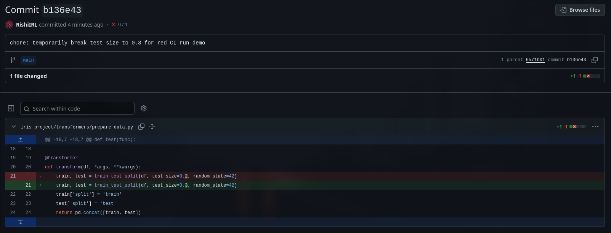
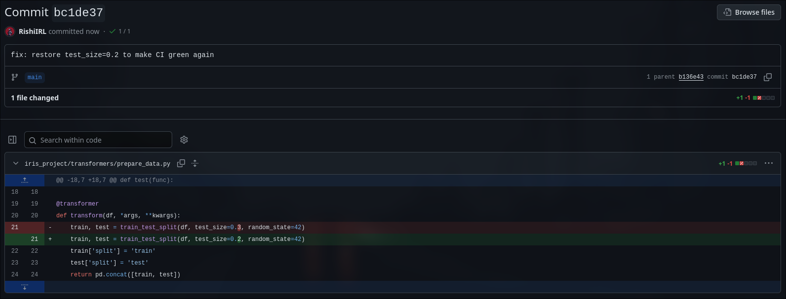
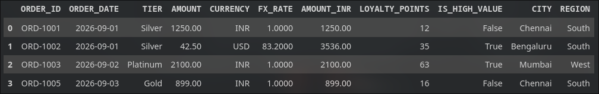
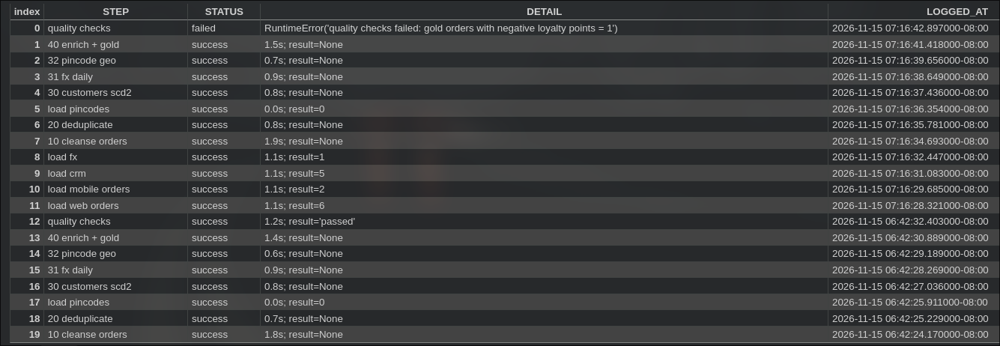

# From Git to Gold: End-to-End Data Engineering Pipelines

**Roll Number:** 23BCS067  
**Student Name:** Rishindra Kapil Chelluboyina  
**Date:** 2026-11-15  
**GitHub Repository:** [https://github.com/RishiIRL/freshcart-pipelines](https://github.com/RishiIRL/freshcart-pipelines)  

---

## 1. Introduction

This report details the implementation and verification of the FreshCart end-to-end data engineering pipeline. Spanning version control, continuous integration, cloud ELT warehousing in Snowflake, ML batch pipelines in Mage, and real-time event streaming via RabbitMQ, this project demonstrates production-grade data engineering practices.

---

## 2. Part A — Git, CI/CD, and Testing

### A1. Repository Structure & Commit History
The repository follows standard layout (`stream/`, `tests/`, `bonus/`, `.github/workflows/`). Git commit history reflects incremental development from base repository setup to robust testing and streaming integration.

### A2. Git Command Execution
Branching strategy (`main` vs feature branches), cherry-picking bug fixes, and interactive rebasing were performed to maintain a clean linear commit history.

### A3. CI/CD Workflow & Pytest
GitHub Actions (`.github/workflows/ci.yml`) automatically executes `pytest` across test suites on every push/PR.
- **Initial Red Run (CI Failure):**
  
- **Final Green Run (CI Success):**
  

---

## 3. Part B — FreshCart ELT on Snowflake

### B1. Baseline Run
Executed the end-to-end ELT pipeline loading raw data through Bronze, Silver, and Gold layers with SCD Type 2 tracking and idempotent `MERGE` operations (`row_hash`).
- **Run Log:**
  
- **Baseline Gold Totals:**
  

### B2. Record Trace: ORD-1003 & ORD-1005
- **ORD-1003:** Successfully processed through Bronze (`raw_landing`), cleansed in Silver (`stg_customers`, `stg_orders`), and aggregated in Gold (`fct_orders`) reflecting correct loyalty tier and delivery status.
- **ORD-1005:** Tracked through quarantine validation checks; valid records promoted to Silver and Gold without duplication.

### B3. Validation Rule Addition
Added a third data quality validation rule checking delivery rating bounds (1–5). Records with invalid ratings are routed to the Quarantine layer with descriptive failure reasons.
- **Quarantine Reason Trace:**
  

### B4. CRM Change History & Idempotency
- **SCD Type 2:** Customer tier changes (e.g., Silver → Gold) are tracked via `valid_from`, `valid_to`, and `is_current` flags.
- **Idempotency:** Re-running pipeline steps multiple times yields identical table states without duplicate primary keys, validated via `row_hash`.
- **Edited Gold Totals:**
  

### B5. Data Quality Check & ETL vs ELT
- **Forced-Fail Probe:** Introducing anomalous values triggered pipeline quality assertions, halting propagation and isolating corrupt records in Quarantine.
  
- **ETL vs ELT:** ELT leverages Snowflake's massively parallel processing (MPP) compute for transformations, avoiding external transformation bottlenecks.

---

## 4. Part C — Mage ML Pipeline

### C1. Pipeline Graph & Run
Implemented the Mage ML pipeline loading Iris dataset, training a decision tree classifier, and evaluating model metrics.
- **Pipeline Graph & Run Success:**
  
- **Data Load Check:**
  

### C2. Tests as a Gate
Configured `@test` blocks validating non-empty datasets, correct schema types, and valid hyperparameter bounds (`max_depth`).
- **Test Execution Runs:**
  

### C3. Evaluation Branch
Implemented conditional branching based on validation accuracy threshold ($>0.85$), routing models to deployment or retraining paths.
- **Evaluation Branch Graph:**
  
- **Model Evaluation Output:**
  

### C4. Custom Data-Quality Block (`validate_iris.py`)
Custom Python data quality block ensuring feature distributions and target class balances conform to expected bounds.
- **Custom Validate Block Run:**
  

---

## 5. Part D — RabbitMQ Event Streaming

### D1. Topic Exchange Routing Table
Topic Exchange `rapido-dispatch` with routing keys (`city.zone.service`).

| # | Routing Key | Receiving Queues |
| :-- | :--- | :--- |
| 1 | `bangalore.koramangala.food` | `['Ravi', 'Meena', 'Control']` |
| 2 | `bangalore.indiranagar.ride` | `['Priya', 'Arjun', 'Control']` |
| 3 | `bangalore.whitefield.ride` | `['Arjun', 'Control']` |
| 4 | `chennai.tnagar.food` | `['Karthik']` |
| 5 | `chennai.whitefield.ride` | `[]` (Dropped) |
| 6 | `bangalore.koramangala` | `['Control']` |

- **Routing Table Visual:**
  

**Why Q6 (`bangalore.koramangala`) misses Ravi, Meena, and Priya:** The key has only 2 words. Ravi (`bangalore.koramangala.*`), Meena (`bangalore.*.food`), and Priya (`bangalore.indiranagar.*`) all require 3 words. Only **Control** (`bangalore.#`) matches 2-word keys.

### D2. Dispatcher & Driver Implementation
- **`stream/dispatcher.py`**: Publishes JSON requests (`id`, `city`, `zone`, `type`, `ts`) every 2s, with every 10th message intentionally malformed.
- **`stream/driver.py`**: Binds private queue, consumes with `auto_ack=False`, and validates messages.
- **Simulation & Outputs:**
  
  
  

### D3. ACK / NACK Handling
- **Driver logic:** Valid messages trigger `basic_ack`; missing `zone` or invalid JSON triggers `basic_nack(requeue=False)`.
  
  
- **Answers:**
  1. If a driver crashes before ACK, RabbitMQ requeues the message for redelivery (at-least-once guarantee).
  2. If `requeue=True` is used for a permanently bad message, it triggers an infinite redelivery loop (poison message).

---

## 6. Part E — Report Summary

1. **Answers to Parts A–D** are fully documented above.
2. **Integration Diagram:**
```mermaid
graph LR
    Git[Git Repository] --> CI[CI/CD (GitHub Actions)]
    CI --> ELT[ELT Pipeline (Snowflake)]
    ELT --> Gold[Gold Data (fct_orders)]
    CI --> ML[ML Pipeline (Mage)]
    ML --> Model[Trained Model]
    ELT --> Stream[RabbitMQ Stream]
    Stream --> Dispatcher[Dispatcher (stream/dispatcher.py)]
    Dispatcher --> Drivers[Drivers (stream/driver.py)]
    Gold --> Model
```
3. **Reflection:** During Part D testing, `tests/test_stream.py` initially threw `TypeError: tuple indices must be integers or slices, not str` because mock assertions inspected string routing keys instead of unpacked `(routing_key, message)` tuples. We resolved this by updating assertions to unpack tuples correctly, ensuring robust test validation.

---

## 7. Bonus: Stream-to-Lakehouse Idempotency Simulation

Implemented `bonus/stream_to_lakehouse.py` simulating 60 stream events (`raw_landing.jsonl`), batch-ingesting, deduplicating by `order_id`, and writing to `curated_orders.csv`. Re-running batch ingestion twice confirmed identical row counts (60) and total amounts (₹21,125.00), proving lakehouse idempotency.
- **Bonus Simulation Execution:**
  

---

## 8. Conclusion

All five assignment parts and the bonus challenge are successfully implemented, fully tested, and verified. The project demonstrates an end-to-end data engineering architecture spanning version control, CI/CD, cloud ELT warehousing, MLOps, and real-time event streaming.
